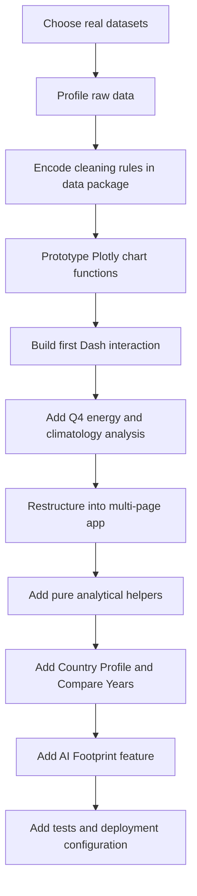

# Global Climate Trends Dashboard

## Complete Project Report

This report describes the implemented project: what it investigates, which datasets it uses, how the data is cleaned, how the Dash application is structured, what each page does, how the analytical calculations work, how the project is tested, and what remains before deployment.

The project is an academic data-visualization dashboard built with Python, Pandas, Plotly, and Dash. It is designed to be read aloud in a viva and to make the difference between measured data, derived values, modeled estimates, and interpretation clear.

## 1. Project Summary

The dashboard investigates global CO2 emissions, observed warming, economic development, renewable electricity adoption, and the estimated environmental cost of AI usage.

The four core research questions are:

1. Has global CO2 growth slowed since 2000?
2. Who emits the most in total, versus per person?
3. Does higher GDP still mean higher emissions per person?
4. Is renewable electricity adoption tracking natural solar or wind potential?

The application also includes three supplementary investigations:

- **Country Climate Profile**: headline metrics and historical trends for one country.
- **Compare Years**: explicit changes in global metrics between two selected years.
- **AI Footprint**: modeled energy, carbon, and water estimates for AI usage, contextualized against a selected country's annual CO2 footprint.

The application has eight routes:

| Route | Page | Purpose |
|---|---|---|
| `/` | Overview | Introduces the questions and displays current headline values |
| `/q1` | Q1: Growth | Compares global CO2 emissions with observed temperature anomalies |
| `/q2` | Q2: Who Emits | Compares total and per-capita emissions geographically and by rank |
| `/q3` | Q3: GDP | Examines GDP per person against CO2 per person |
| `/q4` | Q4: Renewables | Compares renewable adoption with solar or wind climatology |
| `/country` | Country Profile | Shows one country's KPIs and trends |
| `/compare` | Compare Years | Compares global metrics at two years |
| `/ai-footprint` | AI Footprint | Estimates AI-use resource costs and provides country context |

The project is interactive rather than a collection of static images. Users can move year sliders, select countries, switch metrics, choose solar or wind, enter an actual prompt, change usage assumptions, and download selected data.

## 2. Project Development Workflow



### 2.1 Dataset selection

Datasets were selected before chart code was written. This avoids designing a chart around a variable that the source does not actually provide. It also exposed an important scope constraint: the original idea of mapping regional temperature anomalies could not be supported by the selected sources.

### 2.2 Data profiling

`profile_dataset.py` was used to measure row counts, coverage, missingness, aggregate rows, GDP availability, and sparse emissions columns. The measured results became explicit cleaning rules rather than undocumented assumptions.

### 2.3 Centralized loading and cleaning

Source-specific modules under `data/` load the data. Cleaning decisions are kept out of chart functions. This means every page receives the same country filtering, year caps, and missing-value behavior.

### 2.4 Chart prototyping

The chart functions were first implemented as ordinary Python functions that return Plotly figures. Dash callbacks were added after the figures were validated against cleaned data.

### 2.5 Feature expansion

The initial application covered Q1-Q3. It was expanded with Q4, then restructured into a multi-page Dash application. The current version adds the Country Profile, Compare Years, Q4 outlier insight cards, and the AI Footprint page.

## 3. Data Sources and Provenance

| Source | Publisher | Use in this project | License/status |
|---|---|---|---|
| CO2 and Greenhouse Gas Emissions | Our World in Data | CO2, GDP, population, per-capita values, country rankings | CC BY 4.0 |
| Energy | Our World in Data | Renewable electricity share for Q4 and Country Profile | CC BY 4.0 |
| GISTEMP v4 | NASA GISS | Observed global land-ocean temperature anomaly | Public domain |
| POWER climatology | NASA POWER | Solar and wind potential proxies | Public domain |
| AI Footprint reference table | Project-curated, based on published sources | Modeled per-query AI energy, carbon, and water values | Modeled reference data |

### 3.1 OWID CO2 and Greenhouse Gas Emissions

The primary source is:

`https://raw.githubusercontent.com/owid/co2-data/master/owid-co2-data.csv`

It contains country-year observations and aggregate rows. The same file provides the main variables needed for Q1-Q3: total CO2, CO2 per person, GDP, population, and country metadata.

### 3.2 OWID Energy

The Energy source is:

`https://raw.githubusercontent.com/owid/energy-data/master/owid-energy-data.csv`

It shares the `country`, `iso_code`, and `year` key convention with the CO2 source. Q4 uses `renewables_share_elec`, renewable electricity generation as a percentage of electricity generation. The application does not use `renewables_share_energy` because its coverage is much weaker and does not vary sensibly across the tested years.

### 3.3 NASA GISTEMP

The temperature source is NASA GISS GISTEMP v4:

`https://data.giss.nasa.gov/gistemp/tabledata_v4/GLB.Ts+dSST.csv`

The loader handles two source-specific quirks: a preamble row before the header and missing values represented by asterisks. The `J-D` annual value is converted to numeric and exposed as `temperature_anomaly`.

### 3.4 NASA POWER climatology

NASA POWER is used for long-run solar irradiance and wind-speed climatology. The cache is generated once by `scripts/build_climatology_cache.py` from the capital-city reference table in `data/capitals.csv` and stored in `data/power_climatology.csv`.

The deployed application reads this committed CSV. It does not call the NASA POWER API during a page request, so chart interactions do not depend on a live external API call.

The result is a proxy, not a complete national resource assessment: one capital-city sample cannot represent every region, altitude, coastline, or project site in a country.

### 3.5 AI Footprint reference table

`data/ai_footprint.csv` is a curated modeled table with one row per model and use case. It stores estimated `energy_wh`, `co2_g`, `water_ml`, and a prompt length threshold. The table is based on public discussion of generative AI's environmental impact, including MIT News' January 2025 explanation, and is cross-checked for order of magnitude against the ClimateAligned calculator methodology.

These values are not vendor-disclosed measurements and are not real-time telemetry. They are useful for an assumption-driven comparison, not for claiming an exact environmental cost for an individual prompt.

## 4. Cleaning and Data-Quality Rules

The following rules are implemented in the `data/` package and are reused by the pages.

### Rule 1: Remove aggregate rows from country-level views

Country frames keep rows with a non-null three-character ISO code:

```python
df[df["iso_code"].notna() & (df["iso_code"].str.len() == 3)]
```

This excludes rows such as World, continents, income groups, and international aviation from country rankings. The World aggregate is retained in `co2_all` for global time-series charts where it is intentionally the subject of the analysis.

### Rule 2: Cap GDP analysis at 2022

GDP is incomplete and stops being reported after 2022 in the source used by the project. Q3 therefore caps the selected year at `GDP_MAX_YEAR = 2022` and labels the chart when the requested year is later than 2022. The application does not extrapolate GDP.

### Rule 3: Do not convert missing sparse emissions to zero

`coal_co2`, `gas_co2`, and `consumption_co2` have substantial missingness. A missing observation means that the value is unavailable, not that emissions were zero. The project preserves missing values.

### Rule 4: Use a 1990 default analysis range

The default interface range is `1990-2024`, because early historical coverage is thin. The source data remains available for views that need a longer time range.

### Rule 5: Distinguish observed and modeled temperature

GISTEMP is labeled as observed temperature anomaly. The OWID `temperature_change_from_co2` column is modeled attribution and is not used as the observed temperature series in Q1.

### Rule 6: Apply a population floor to per-capita rankings

Per-capita ranking views exclude countries with population below 1,000,000. This avoids a ranking dominated by very small petro-states and keeps the comparison aligned with the question about broad national patterns.

### Rule 7: Use renewable electricity share and cap it at 2023

Q4 and the relevant supplementary views use `renewables_share_elec`. Coverage drops after 2023, so `ENERGY_MAX_YEAR = 2023` is the upper bound for Q4 and renewable comparisons.

### Missing data behavior

Pure helpers return `None` when a requested value is unavailable rather than fabricating zero. The UI displays `No data` or `n/a` where appropriate. This is especially important for country KPIs, year comparisons, and the AI Footprint per-capita comparison.

## 5. Application Architecture

```mermaid
flowchart LR
    SOURCES[OWID CO2, OWID Energy, NASA GISTEMP, NASA POWER cache, AI CSV]
    LOAD[data.load_all()]
    STATE[state.loaded]
    PAGES[Dash pages and callbacks]
    CHARTS[Pure Plotly chart builders]
    BROWSER[Interactive browser figures and downloads]

    SOURCES --> LOAD --> STATE --> PAGES
    PAGES --> CHARTS --> BROWSER
    PAGES --> BROWSER
```

### 5.1 Startup loading

`state.py` imports `data.load_all()` once. `LoadedData` stores:

- `co2_all`: the full OWID CO2 frame, including World and other aggregates;
- `co2_countries`: the ISO-filtered country frame;
- `temperature`: parsed GISTEMP annual values;
- `energy`: OWID Energy data;
- `climatology`: the committed NASA POWER cache;
- `ai_footprint`: the local modeled reference table.

The data is loaded into memory once so slider and dropdown callbacks reuse the same frames instead of downloading data repeatedly.

### 5.2 Separation of responsibilities

| Layer | Responsibility |
|---|---|
| `data/` | Load sources, expose constants, and apply reusable data rules |
| `analysis.py` | Pure numeric and country-series helpers |
| `ai_footprint_analysis.py` | Prompt bucketing and per-capita share calculations |
| `prototype_charts.py` | Q1-Q3 Plotly figures |
| `q4_charts.py` | Q4 bubble chart, trend residuals, and outlier details |
| `country_profile_charts.py` | Country trend figure |
| `ai_footprint_charts.py` | AI model comparison and per-capita figures |
| `pages/` | Layouts, controls, callbacks, and downloads |
| `app.py` | Dash shell, navigation, footer, and server object |
| `tests/` | Focused tests for data rules, helpers, and chart calculations |

## 6. Page-by-Page Functionality

### 6.1 Overview (`/`)

The overview introduces the four research questions and the three supplementary pages. It also calculates current headline values from the loaded data:

- latest global CO2 emissions;
- latest available observed GISTEMP anomaly;
- latest-year top country emitter.

The top emitter is calculated from the country-filtered frame, so the World aggregate cannot incorrectly appear as a country.

### 6.2 Q1: Growth (`/q1`)

Controls:

- year slider from 1990 to the latest CO2 year;
- selected year is shown by a vertical marker.

Outputs:

1. A dual-axis line chart with global CO2 emissions and observed GISTEMP anomaly.
2. A year-over-year global CO2 growth-rate bar chart.
3. A five-year rolling average overlaid on the growth chart.
4. An annotation comparing mean growth in 1990-1999 with mean growth in 2015-2024.

The two axes are necessary because emissions and temperature anomaly have different units and scales. The growth-rate view answers the word "slowed" more directly than a raw emissions line alone.

### 6.3 Q2: Who Emits (`/q2`)

Controls:

- year slider;
- optional multi-country filter;
- Total versus Per capita map metric toggle;
- filtered CSV download.

Outputs:

- a Plotly choropleth using ISO-3 locations;
- paired horizontal bars showing the top 15 by total CO2 and by CO2 per person.

The map metric changes the color field. The per-capita view applies the 1-million population floor. The paired bars make the difference between absolute responsibility and individual-average emissions visible.

The download contains the selected year from the filtered country frame and is named `q2_emitters_<year>.csv`.

### 6.4 Q3: GDP (`/q3`)

Controls:

- year slider;
- optional multi-country filter;
- filtered CSV download.

Output:

- a bubble scatter plot with GDP per person on a logarithmic x-axis, CO2 per person on the y-axis, and population represented by bubble size;
- continent color where that metadata is present.

GDP per person is derived as `gdp / population`. Rows missing GDP, population, or CO2 per person are excluded from the plotted frame. Requested years after 2022 are capped at 2022 and identified in the title.

The download contains the selected year from the optional country filter and is named `q3_gdp_<year>.csv`.

### 6.5 Q4: Renewables (`/q4`)

Controls:

- year slider capped at 2023;
- Solar versus Wind potential toggle;
- merged-data CSV download.

The bubble chart uses:

- x-axis: solar irradiance or wind speed from the POWER climatology;
- y-axis: renewable electricity share;
- bubble size: population;
- labels: only the most extreme trend residual countries.

For the selected potential, the chart merges energy data and climatology by ISO code, removes rows missing the plotted variables, and fits a straight line with `numpy.polyfit`. A residual is the observed renewable share minus the share predicted by that line:

```text
residual = observed renewable share - predicted renewable share
```

The page also displays two insight groups:

- **Adoption Leaders**: countries furthest above the fitted trend;
- **Potential Under-Utilisers**: countries furthest below the fitted trend.

These are relative statistical outliers, not causal conclusions. The page explicitly states that a capital-city climatology sample is only a proxy for national potential. The download is named `q4_renewables_<year>.csv`.

### 6.6 Country Climate Profile (`/country`)

The country selector defaults to the latest-year top emitter. For the selected country, the page displays current available values for:

- population;
- GDP per person;
- total CO2 emissions;
- CO2 per person;
- renewable electricity share.

It also displays a combined trend figure from 1990 onward for CO2, CO2 per person, GDP per person, and renewable electricity. GDP ends at 2022 and renewable electricity ends at 2023, while the other series use their own available coverage. Each KPI includes its source year so that different latest years are not mistaken for one common observation date.

### 6.7 Compare Years (`/compare`)

The user selects a from-year and a to-year. The page compares:

- global CO2 emissions;
- global CO2 per person;
- renewable electricity share;
- observed temperature anomaly.

CO2 and renewable share use percentage change:

```text
percentage change = (to - from) / from * 100
```

Temperature uses absolute change in degrees Celsius because percentage change near a zero anomaly baseline is not meaningful:

```text
absolute change = to - from
```

Renewable share comparisons are capped at 2023. Missing values are displayed as `n/a`.

### 6.8 AI Footprint (`/ai-footprint`)

This is the newest feature and extends the climate dashboard into a practical AI-use comparison. It combines a local modeled reference table with the same country CO2 data used elsewhere in the application.

Controls:

- select models to compare;
- select the primary model for projection;
- select a use case;
- enter queries per day;
- choose five or seven active days per week;
- select a comparison country;
- optionally paste a real prompt.

Use cases are bucketed by prompt length:

- Simple Q&A: up to 15 words;
- Email / Summary: up to 60 words;
- Document Review: up to 200 words;
- Coding / Agent Session: the largest bucket.

When a prompt is entered, its word count overrides the use-case dropdown. Empty or whitespace-only input falls back to the selected use case.

The page provides:

1. A three-panel model comparison for energy, carbon, and water per query.
2. Monthly projected energy, carbon, and water KPIs.
3. A comparison of monthly AI carbon against one person's annual CO2 footprint in the selected country.
4. A download of the full modeled reference table.

The monthly projection is:

```text
monthly queries = queries per day * days per week * (52 / 12)
monthly metric = per-query metric * monthly queries
```

For the country comparison, monthly grams of CO2 are converted to tonnes and divided by the country's latest available CO2-per-person value:

```text
share (%) = (monthly CO2 grams / 1,000,000) / annual CO2 tonnes per person * 100
```

The feature is deliberately labeled as modeled. Actual costs vary with model architecture, hardware, utilization, region, electricity mix, cooling, and software version. The water comparison uses a global-average assumption and is not country-specific.

## 7. Why These Tools Were Chosen

### Python and Pandas

Python matches the course context and provides a clear data-cleaning workflow. Pandas handles CSV loading, filtering, joins, missing values, group-level operations, and derived columns in a compact and testable way.

### Plotly

Plotly was selected because it provides interactive hover, zoom, pan, legends, choropleths, subplots, dual axes, logarithmic axes, and bubble sizing through Python figure objects. The figures can be returned directly through Dash callbacks without writing custom JavaScript chart logic.

### Dash

Dash turns Plotly figures into a Python web application. Its explicit `Input` and `Output` callback declarations make the relationship between a control and a chart easy to inspect and explain. `dash.page_registry` and `dash.page_container` provide multi-page navigation while keeping each page's layout and callbacks in its own module.

### Why not Matplotlib?

Matplotlib is excellent for static, publication-quality figures, but the assignment requires a live dashboard. Re-rendering static images for every slider interaction would add work and remove native hover, pan, and zoom.

### Why not Streamlit?

Streamlit was a valid alternative. Dash was chosen because its callback graph is explicit: each input and output is named, which makes the data flow easier to test and defend in a viva.

### Why not D3.js?

D3 provides more control but requires JavaScript and direct DOM management. That would move the main implementation away from the Python data-visualizing skill this project is intended to demonstrate.

## 8. Testing and Quality Assurance

The repository contains focused tests under `tests/`. They cover:

- aggregate filtering;
- GDP year capping;
- minimum population filtering;
- GISTEMP preamble and asterisk parsing;
- energy metric selection and year limits;
- capital reference data and climatology cache generation;
- rolling growth averages and period means;
- country series extraction and latest-value handling;
- GDP-per-capita derivation without mutating source data;
- percentage and absolute year changes;
- top-emitter selection;
- Q4 trend residuals and outlier details;
- AI prompt-length buckets;
- AI per-capita share calculations;
- AI reference-table integrity.

The test suite is designed around the highest-risk assumptions: data cleaning, missing-value semantics, derived calculations, and the Q4/AI feature logic. Plotly and Dash rendering are kept separate from most numeric tests so the core calculations can be checked without a browser.

The project also includes `docs/demo/`, a small offline Matplotlib and Plotly comparison using illustrative data. It demonstrates the difference between a static chart and an interactive Plotly figure without requiring the full dashboard data download.

## 9. Deployment Plan

The application is configured for a free Render Web Service.

Build command:

```text
pip install -r requirements.txt
```

Start command:

```text
gunicorn app:server
```

The same entry point is stored in `Procfile`.

The application needs no API keys. OWID and GISTEMP are public CSV sources, and the NASA POWER values used at runtime are already committed in the local cache. Render deployment is the remaining release step; this report should not be read as claiming that a live public URL has already been verified.

After deployment, the recommended smoke test is:

1. Open all eight routes.
2. Move each year slider.
3. Change the Q2 metric and country filter.
4. Check the Q3 GDP cap after 2022.
5. Toggle solar and wind on Q4 and inspect both outlier groups.
6. Select different countries on Country Profile.
7. Compare early and recent years on Compare Years.
8. Enter prompts of different lengths on AI Footprint.
9. Test Q2, Q3, Q4, and AI Footprint CSV downloads.

## 10. Limitations and Responsible Interpretation

### Temperature geography

The application does not show a country-level observed temperature map. NASA GISTEMP provides global, hemispheric, and zonal summaries rather than the country-level observations required for that map. The dashboard therefore uses a global temperature line and an emissions choropleth.

### Correlation is not causation

The Q3 scatter does not prove that GDP causes emissions. The Q4 residuals do not prove that resource potential causes adoption or that policy is the cause of an outlier. They identify descriptive relationships worth investigating.

### Proxy potential

Q4 uses one capital-city climatology point per country. It is a comparable proxy, not a national engineering estimate of deployable renewable potential.

### Incomplete source coverage

GDP and renewable electricity have different end years and missingness patterns. The UI preserves these limits and shows source years or caps rather than silently filling or extrapolating values.

### Modeled AI values

The AI Footprint feature is an estimation tool. Its purpose is to communicate scale and assumptions, not to report measured vendor-level environmental accounting.

## 11. File Guide

| File or folder | Responsibility |
|---|---|
| `app.py` | Dash app shell, navigation, footer, server |
| `state.py` | One-time startup loading into `state.loaded` |
| `data/__init__.py` | `LoadedData` and source orchestration |
| `data/co2.py` | CO2 loading and shared cleaning constants/helpers |
| `data/energy.py` | Renewable electricity metric and year cap |
| `data/gistemp.py` | GISTEMP parsing |
| `data/climatology.py` | Offline POWER cache loading |
| `data/ai_footprint.py` | AI reference-table loading and provenance |
| `analysis.py` | General pure analytical helpers |
| `ai_footprint_analysis.py` | AI prompt and comparison calculations |
| `prototype_charts.py` | Q1-Q3 figures |
| `q4_charts.py` | Q4 figure and outlier calculations |
| `country_profile_charts.py` | Country trend figure |
| `ai_footprint_charts.py` | AI charts |
| `pages/` | Eight route modules and callbacks |
| `scripts/build_climatology_cache.py` | One-time cache-building script |
| `tests/` | Unit tests |
| `docs/demo/` | Offline Matplotlib/Plotly demonstration |
| `requirements.txt` | Runtime dependencies |
| `Procfile` | Gunicorn deployment command |

## 12. Viva Talking Points

**Why filter aggregates?** Country rankings must not include World or continent rows, otherwise totals are duplicated and the ranking is invalid.

**Why use two Q1 axes?** CO2 and temperature anomaly have different units; separate axes preserve their meanings instead of pretending they share a scale.

**Why use a log GDP axis?** GDP per person spans several orders of magnitude. A linear axis would compress most countries into a small area.

**Why is Q4 not causal?** The residual only measures whether adoption is above or below a fitted descriptive trend. It does not identify the policy, investment, grid, or geographic reason.

**Why is the AI page labeled modeled?** There is no standardized, complete, vendor-disclosed per-query environmental measurement across all selected models. The table is an assumption-based reference for comparison.

**Why does Country Profile show different years in its KPIs?** Each source has different coverage. Showing the actual source year is more honest than forcing all metrics into a fabricated common year.

**Why Dash instead of a notebook?** A notebook can be interactive locally, but Dash provides a deployable web application with routes, callbacks, downloads, and a WSGI server entry point.

## 13. Final Status

Implemented and documented:

- four research-question pages;
- overview page;
- Country Climate Profile;
- Compare Years;
- Q4 residual outlier cards;
- AI Footprint analysis page;
- centralized data loading and cleaning;
- offline NASA POWER cache;
- CSV downloads on Q2, Q3, Q4, and AI Footprint;
- pure analytical helpers and focused tests;
- Render/Gunicorn deployment configuration.

The remaining operational task is deployment to Render and a live smoke test of every route, callback, and download against the deployed URL.
